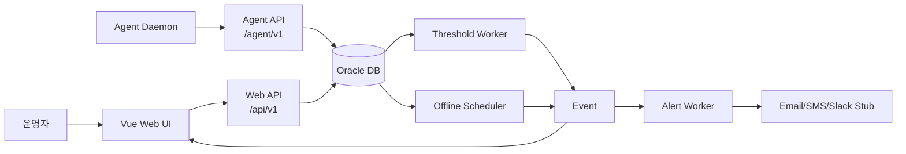
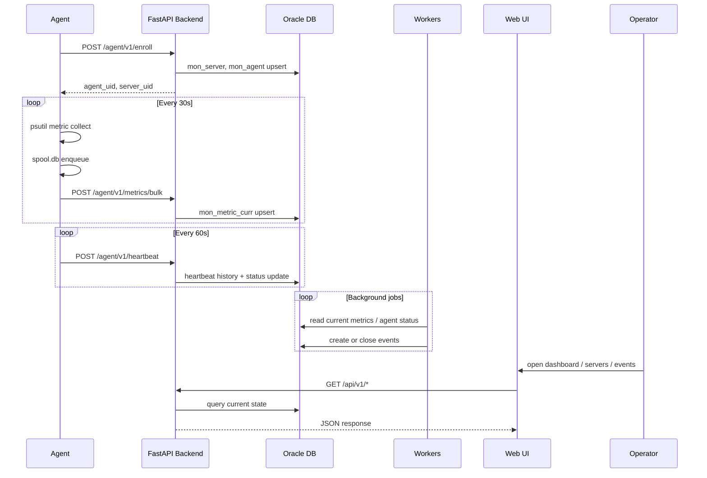
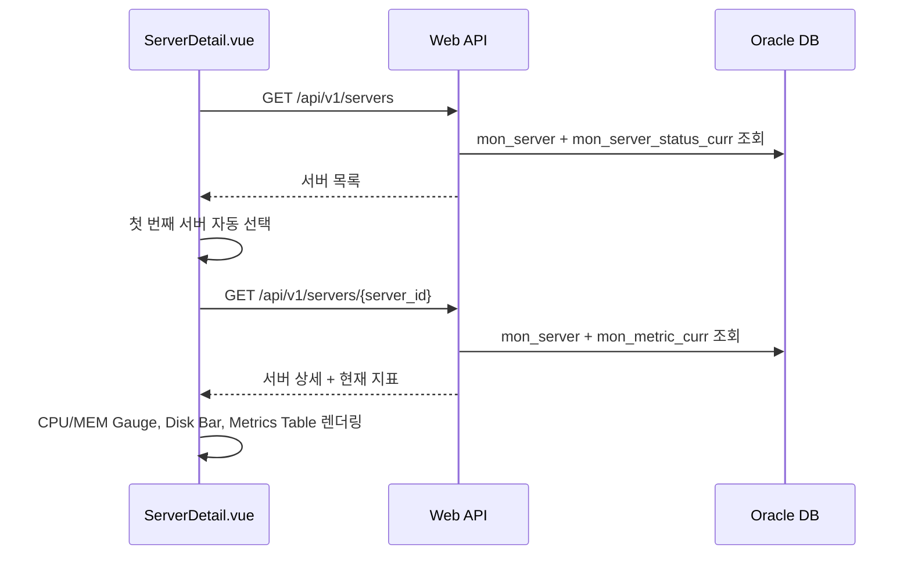

# Nexus Mon Product Workflow

> 작성일: 2026-07-10  
> 대상: 운영자, 개발자, 유지보수 담당자  
> 목적: Nexus Mon 제품이 에이전트 설치부터 모니터링, 이벤트 감지, 알림, 운영자 조치까지 어떤 흐름으로 동작하는지 상세히 설명한다.

---

## 1. 제품 개요

Nexus Mon은 서버에 설치된 Agent가 시스템 자원 지표를 수집하고, 중앙 FastAPI 백엔드가 이를 저장/판정한 뒤, Vue 기반 Web UI에서 운영자가 서버 상태와 장애 이벤트를 확인하는 통합 서버 모니터링 시스템이다.

제품의 핵심 흐름은 다음과 같다.



---

## 2. 주요 사용자와 역할

| 사용자/컴포넌트 | 역할 |
|---|---|
| 운영자 | 웹 화면에서 대시보드, 서버 상세, 에이전트 상태, 이벤트, 인시던트를 확인하고 ACK 처리한다. |
| Agent Daemon | 서버에 상주하며 CPU, 메모리, 디스크, 네트워크 지표를 수집하고 중앙 API로 전송한다. |
| FastAPI Backend | Agent 등록/인증/수신, Web API 제공, 백그라운드 Worker 실행을 담당한다. |
| Oracle DB | 서버, 에이전트, 현재 지표, 이벤트, 인시던트, 관리자 정보를 저장한다. |
| Background Workers | 임계치 판정, Agent 미수신 감지, 알림 발송, 지표 집계 작업을 주기적으로 수행한다. |
| Vue Frontend | 운영자가 보는 SPA 화면을 제공하고 백엔드 API와 통신한다. |

---

## 3. 전체 업무 흐름 요약

### 3.1 운영 흐름

1. 백엔드 서버를 실행한다.
2. 프론트엔드 개발 서버 또는 배포 서버를 실행한다.
3. Agent를 각 모니터링 대상 서버에서 실행한다.
4. Agent가 중앙 서버에 최초 등록한다.
5. 중앙 서버는 서버/Agent 정보를 DB에 저장하고 `agent_uid`를 발급한다.
6. Agent는 주기적으로 하트비트와 지표를 전송한다.
7. 백엔드는 현재 지표를 저장하고 에이전트 상태를 갱신한다.
8. Worker가 현재 지표와 이벤트 룰을 비교해 장애 이벤트를 생성/복구한다.
9. Alert Worker가 미발송 이벤트를 감지해 알림 채널로 전달한다.
10. 운영자는 Web UI에서 Dashboard, Servers, Agents, Events, Incidents를 확인한다.
11. 운영자는 필요한 이벤트를 ACK 처리하고 장애 조치 이력을 관리한다.

### 3.2 데이터 흐름



---

## 4. 시스템 기동 워크플로우

### 4.1 백엔드 기동

명령:

```powershell
cd e:\monitor\backend
uvicorn app.main:app --reload --host 0.0.0.0 --port 8000
```

기동 시 처리:

1. `backend/app/main.py`가 FastAPI 앱을 생성한다.
2. CORS가 `http://localhost:5173`, `http://127.0.0.1:5173`을 허용한다.
3. `/agent/v1`, `/api/v1`, `/api/v1/admin` 라우터가 등록된다.
4. lifespan 시작 시 다음 백그라운드 작업이 함께 시작된다.
   - `worker.py`: 임계치 기반 이벤트 판정
   - `scheduler.py`: Agent 하트비트 미수신 감지
   - `alert_worker.py`: 알림 발송 처리
   - `aggregator.py`: 지표 이력/집계 처리

### 4.2 프론트엔드 기동

명령:

```powershell
cd e:\monitor\frontend
npm run dev
```

기동 시 처리:

1. Vite 개발 서버가 실행된다.
2. 기본 접속 URL은 `http://localhost:5173`이다.
3. `frontend/vite.config.ts`의 proxy 설정에 따라 다음 경로가 백엔드로 전달된다.
   - `/api` -> `http://127.0.0.1:8000`
   - `/agent` -> `http://127.0.0.1:8000`
   - `/health` -> `http://127.0.0.1:8000`

### 4.3 Agent 기동

명령:

```powershell
python e:\monitor\agent\agent.py
```

기동 시 처리:

1. `agent_uid.txt`, `server_uid.txt`가 있으면 기존 UID를 읽는다.
2. UID가 없으면 `/agent/v1/enroll`로 최초 등록한다.
3. 등록 성공 후 `agent_uid.txt`, `server_uid.txt`에 UID를 저장한다.
4. 이후 메인 루프에서 수집, 전송, 하트비트를 반복한다.

---

## 5. Agent 등록 워크플로우

### 5.1 최초 등록

Agent는 최초 실행 시 다음 정보를 백엔드에 전달한다.

| 필드 | 설명 |
|---|---|
| `host_name` | 서버 호스트명 |
| `os_type_code` | `WINDOWS` 또는 `LINUX` |
| `os_name` | OS 이름 |
| `os_version` | OS 버전 |
| `mgmt_ip` | 관리 IP |
| `service_ip` | 서비스 IP |
| `agent_version` | Agent 버전 |
| `install_path` | 설치 경로 |
| `run_account` | 실행 계정 |

호출 API:

```http
POST /agent/v1/enroll
Content-Type: application/json
```

백엔드 처리:

1. 동일한 `host_name + mgmt_ip`를 가진 서버가 있는지 확인한다.
2. 기존 서버가 있으면 `mon_server` 정보를 갱신하고 재사용한다.
3. 기존 Agent가 있으면 `mon_agent` 정보를 갱신하고 새 `agent_uid`를 발급한다.
4. 기존 Agent가 없으면 새 Agent를 생성한다.
5. 서버 상태는 `UNKNOWN`, Agent 상태는 `NORMAL`로 초기화한다.
6. `agent_uid`, `server_uid`, `server_id`, `agent_id`를 반환한다.

응답 예:

```json
{
  "success": true,
  "code": "ENROLLED",
  "data": {
    "agent_uid": "...",
    "server_uid": "...",
    "server_id": 1,
    "agent_id": 1,
    "status_code": "APPROVED"
  }
}
```

### 5.2 Agent 인증

등록 이후 Agent API는 `X-Agent-Uid` 헤더를 요구한다.

```http
X-Agent-Uid: {agent_uid}
```

백엔드 인증 흐름:

1. `backend/app/api/dependencies.py`의 `verify_agent`가 헤더를 읽는다.
2. `mon_agent.agent_uid`와 일치하는 Agent를 조회한다.
3. Agent가 없으면 `401 Unauthorized`를 반환한다.
4. Agent 상태가 `APPROVED`가 아니면 `403 Forbidden`을 반환한다.
5. 인증에 성공하면 API 핸들러에 Agent ORM 객체를 전달한다.

---

## 6. 지표 수집 워크플로우

### 6.1 수집 대상

현재 공통 수집기는 `agent/collectors/common.py`에서 `psutil` 기반으로 다음 지표를 수집한다.

| 지표 코드 | 설명 | 단위 |
|---|---|---|
| `CPU_USAGE_PCT` | CPU 사용률 | Percent |
| `MEM_USAGE_PCT` | 메모리 사용률 | Percent |
| `MEM_AVAILABLE_BYTES` | 사용 가능 메모리 | Bytes |
| `DISK_USAGE_PCT` | 루트 또는 C 드라이브 사용률 | Percent |
| `DISK_AVAILABLE_BYTES` | 사용 가능 디스크 | Bytes |
| `NET_BYTES_SENT` | 네트워크 송신 누적 바이트 | Bytes |
| `NET_BYTES_RECV` | 네트워크 수신 누적 바이트 | Bytes |

### 6.2 로컬 스풀

Agent는 수집한 지표를 곧바로 네트워크로만 보내지 않고 `spool.db`에 먼저 적재한다.

목적:

- 백엔드 일시 장애 또는 네트워크 단절 시 데이터 유실 방지
- 재시도 가능한 로컬 큐 제공
- 전송 성공 여부와 수집 성공 여부 분리

흐름:

1. Collector가 지표 배열을 만든다.
2. `MetricSpooler.push()`가 각 지표를 JSON으로 `metrics_spool`에 저장한다.
3. `flush_spool()`이 `METRICS_BATCH_SIZE` 단위로 꺼낸다.
4. 백엔드 전송 성공 시 pop된 데이터는 삭제된 상태로 유지된다.
5. 전송 실패 시 같은 batch를 다시 `push()`하여 다음 주기에 재전송한다.

### 6.3 Bulk 전송

호출 API:

```http
POST /agent/v1/metrics/bulk
X-Agent-Uid: {agent_uid}
Content-Type: application/json
```

payload 구조:

```json
{
  "batch_uid": "uuid",
  "sequence": 0,
  "collected_at": "2026-07-10T02:24:41Z",
  "items": [
    {
      "metric_code": "CPU_USAGE_PCT",
      "dimension_key": "-",
      "dimension_value": "-",
      "metric_value": 48.8,
      "status_code": "OK",
      "quality_code": "GOOD",
      "collected_at": "2026-07-10T02:24:41Z"
    }
  ]
}
```

백엔드 처리:

1. Agent 인증을 수행한다.
2. batch 내부에서 동일한 현재값 키를 정리한다.
   - 기준: `metric_code + dimension_key + dimension_value`
   - 같은 키가 여러 개면 최신 `collected_at` 값만 유지한다.
3. `mon_metric_curr`에 현재값을 UPSERT한다.
4. Agent의 `last_connected_at`, `updated_at`을 갱신한다.
5. 성공 응답을 반환한다.

현재 주의사항:

- `mon_metric_hist`는 DB 파티션 문제(`ORA-14400`)가 해결될 때까지 저장이 임시 비활성화되어 있다.
- 화면의 현재 CPU/MEM/DISK 표시는 `mon_metric_curr`를 사용하므로 정상 동작한다.
- 장기 추세/이력 차트를 운영하려면 히스토리 파티션 생성 후 이력 저장을 다시 활성화해야 한다.

---

## 7. 하트비트 워크플로우

Agent는 기본 60초마다 하트비트를 전송한다.

호출 API:

```http
POST /agent/v1/heartbeat
X-Agent-Uid: {agent_uid}
Content-Type: application/json
```

payload:

```json
{
  "agent_version": "1.0.0",
  "local_queue_count": 0,
  "collector_statuses": null
}
```

백엔드 처리:

1. Agent 인증을 수행한다.
2. `mon_agent_heartbeat_hist`에 하트비트 이력을 저장한다.
3. `mon_agent_status_curr`를 UPSERT한다.
   - `agent_status`: `NORMAL`
   - `delay_ms`: 0
   - `local_queue_count`: Agent가 보낸 스풀 대기 건수
   - `last_heartbeat_at`: 현재 시각
4. `mon_agent.last_connected_at`을 갱신한다.
5. Agent 버전이 payload에 있으면 `mon_agent.agent_version`도 갱신한다.

---

## 8. 서버 상세 화면 워크플로우

운영자가 `http://localhost:5173/servers`에 접속하면 다음 흐름이 실행된다.



프론트 처리:

1. `ServerDetail.vue`가 mount될 때 `/api/v1/servers`를 호출한다.
2. 서버 목록을 받아 첫 번째 서버를 자동 선택한다.
3. 선택된 서버의 `/api/v1/servers/{id}`를 호출한다.
4. 응답의 `metrics` 배열에서 CPU/MEM/DISK 지표를 찾는다.
5. `vue-echarts` Gauge/Bar 차트 옵션을 계산한다.
6. All Metrics 테이블에 원본 지표를 표시한다.

지표 매핑:

| 화면 요소 | 우선 조회 코드 |
|---|---|
| CPU Gauge | `SYS_CPU_USAGE`, `CPU_USAGE_PCT`, `CPU_USAGE`, `cpu_usage` |
| Memory Gauge | `SYS_MEM_USAGE`, `MEM_USAGE_PCT`, `MEM_USAGE`, `mem_usage` |
| Disk Bar | `SYS_DISK_USAGE`, `DISK_USAGE_PCT`, `DISK_USAGE`, `disk_usage` |

현재 Agent 수집 코드 기준으로 실제 매칭되는 값은 다음이다.

- CPU: `CPU_USAGE_PCT`
- Memory: `MEM_USAGE_PCT`
- Disk: `DISK_USAGE_PCT`

---

## 9. Dashboard 워크플로우

Dashboard는 전체 상태를 빠르게 보는 운영자 첫 화면이다.

호출 API:

| API | 목적 |
|---|---|
| `GET /api/v1/dashboard/summary` | 서버 수, 상태별 서버 수, Agent 수, 온라인 Agent 수, OPEN 이벤트 수 |
| `GET /api/v1/events?status=OPEN` | 최근 OPEN 이벤트 목록 |

처리 흐름:

1. `Dashboard.vue`가 mount된다.
2. summary API와 events API를 병렬 호출한다.
3. KPI 카드에 전체 서버, 정상/경고/장애 상태, Active Agents, Open Events를 표시한다.
4. 최근 이벤트 테이블에 OPEN 이벤트 최대 10건을 표시한다.
5. OPEN 이벤트가 없으면 All Clear 상태를 보여준다.

---

## 10. Agent 관리 워크플로우

운영자가 `/agents` 화면에 접근하면 Agent 목록과 상태를 확인할 수 있다.

호출 API:

| API | Method | 목적 |
|---|---|---|
| `/api/v1/agents` | GET | Agent 목록 및 현재 상태 조회 |
| `/api/v1/agents/{agent_id}/approve` | PUT | Agent 승인 |
| `/api/v1/agents/{agent_id}/revoke` | PUT | Agent 차단/철회 |

조회 흐름:

1. `AgentList.vue`가 `/api/v1/agents`를 호출한다.
2. 백엔드는 `mon_agent`, `mon_agent_status_curr`, `mon_server`를 조합해 응답한다.
3. 화면은 Agent 상태, 버전, 호스트, 마지막 하트비트 시간을 표시한다.

승인/철회 흐름:

1. 운영자가 Approve 또는 Revoke 버튼을 클릭한다.
2. 프론트가 PUT API를 호출한다.
3. 백엔드는 `mon_agent.status_code`를 변경한다.
4. 프론트는 목록을 다시 조회한다.

주의:

- Agent API 인증은 `status_code == APPROVED`인 Agent만 통과한다.
- Revoke된 Agent는 이후 heartbeat/metrics/config 호출에서 거부된다.

---

## 11. 이벤트 판정 워크플로우

### 11.1 임계치 기반 이벤트

`backend/app/worker.py`의 Threshold Worker가 30초마다 실행된다.

흐름:

1. `mon_event_rule`에서 `use_yn = 'Y'`인 룰을 조회한다.
2. 룰을 `target_metric` 기준으로 그룹화한다.
3. `mon_metric_curr`의 모든 현재 지표를 조회한다.
4. 각 지표의 `metric_code`와 매칭되는 룰을 찾는다.
5. `fatal_threshold`, `crit_threshold`, `warn_threshold` 순으로 조건을 평가한다.
6. 조건에 걸리면 severity를 `FATAL`, `CRITICAL`, `WARNING` 중 하나로 결정한다.
7. 같은 룰/서버/대상키의 OPEN 이벤트가 있으면 occurrence를 증가시키고 severity를 갱신한다.
8. OPEN 이벤트가 없으면 새 `mon_event`를 생성한다.
9. 정상 범위로 복구되면 기존 OPEN 이벤트를 `CLOSED`로 변경하고 `recovered_at`을 기록한다.

이벤트 생성 기준:

| 항목 | 값 |
|---|---|
| `target_type_code` | `SERVER` |
| `target_key` | 지표의 `dimension_value` |
| `status_code` | `OPEN` |
| `first_occurred_at` | 최초 발생 시각 |
| `last_occurred_at` | 마지막 발생 시각 |
| `occurrence_count` | 반복 발생 횟수 |

### 11.2 Agent 미수신 이벤트

`backend/app/scheduler.py`의 Offline Scheduler가 1분마다 실행된다.

흐름:

1. 현재 시각에서 2분을 뺀 값을 기준 시각으로 계산한다.
2. `mon_agent_status_curr.last_heartbeat_at`이 기준 시각보다 오래된 Agent를 조회한다.
3. 아직 `OFFLINE` 상태가 아니면 상태를 `OFFLINE`으로 변경한다.
4. 같은 Agent에 대한 OPEN 미수신 이벤트가 없으면 새 이벤트를 생성한다.
5. 이후 하트비트가 다시 들어와 상태가 `NORMAL`이 되면 OPEN 미수신 이벤트를 `CLOSED` 처리한다.

---

## 12. 알림 워크플로우

`backend/app/alert_worker.py`의 Alert Worker가 30초마다 실행된다.

흐름:

1. `mon_event`에서 `status_code = 'OPEN'`이고 아직 `[ALERT_SENT]`가 없는 이벤트를 조회한다.
2. `mon_alert_policy`에서 활성 정책을 조회한다.
3. 이벤트의 `severity_code`와 매칭되는 알림 정책을 찾는다.
4. 정책의 `notify_channel`에 따라 대상자를 결정한다.
5. `Notifier.dispatch()`를 호출한다.
6. 이벤트 message에 `[ALERT_SENT]`를 붙여 중복 발송을 방지한다.

현재 채널 처리:

| 채널 | 현재 동작 |
|---|---|
| `EMAIL` | `admin@nexusmon.local` 대상 stub |
| `SMS` | `010-0000-0000` 대상 stub |
| `SLACK` | Webhook URL stub |

---

## 13. 이벤트/인시던트 운영자 화면 워크플로우

### 13.1 Events 화면

호출 API:

| API | Method | 목적 |
|---|---|---|
| `/api/v1/events` | GET | 이벤트 목록 조회 |
| `/api/v1/events?status=OPEN` | GET | OPEN 이벤트 필터 |
| `/api/v1/events/{event_uid}/ack` | PUT | 이벤트 ACK 처리 |

흐름:

1. 운영자가 `/events`로 이동한다.
2. 화면은 이벤트 목록을 조회한다.
3. 운영자는 `ALL`, `OPEN`, `CLOSED` 필터를 선택할 수 있다.
4. OPEN 이벤트는 ACK 버튼을 표시한다.
5. ACK 클릭 시 백엔드가 `ack_at`을 현재 시각으로 기록한다.

ACK의 의미:

- 이벤트를 즉시 종료하는 것이 아니라 운영자가 확인했음을 기록한다.
- 장애가 복구되면 Worker가 별도로 `CLOSED` 처리한다.

### 13.2 Incidents 화면

호출 API:

| API | Method | 목적 |
|---|---|---|
| `/api/v1/incidents` | GET | 인시던트 목록 조회 |

흐름:

1. 운영자가 `/incidents`로 이동한다.
2. 화면은 장애 인시던트 목록을 조회한다.
3. 인시던트 ID, 제목, 상태, 영향도, 원인, 감지/해결 시각을 표시한다.

현재 상태:

- 인시던트 조회 화면은 구현되어 있다.
- 이벤트와 인시던트의 자동 연결/조치 이력 입력은 후속 고도화 영역이다.

---

## 14. 관리자 인증 워크플로우

관리자 기능은 JWT 인증을 사용한다.

로그인 API:

```http
POST /api/v1/admin/auth/login
Content-Type: application/x-www-form-urlencoded
```

프론트 처리:

1. `Login.vue`에서 ID/PW를 입력한다.
2. 로그인 성공 시 access token을 `localStorage.access_token`에 저장한다.
3. `api.ts` axios interceptor가 모든 요청에 `Authorization: Bearer {token}`을 추가한다.
4. 401 응답이 오면 토큰과 사용자 정보를 지우고 `/login`으로 이동한다.

라우터 처리:

1. `frontend/src/router/index.ts`의 `beforeEach` guard가 로그인 여부를 확인한다.
2. 인증이 필요한 페이지에서 토큰이 없으면 `/login`으로 보낸다.
3. 로그인된 사용자가 `/login`에 접근하면 Dashboard로 이동한다.

---

## 15. 장애/복구 시나리오

### 15.1 백엔드 일시 중단

1. Agent는 계속 지표를 수집한다.
2. `/metrics/bulk` 전송이 실패한다.
3. 실패한 batch는 `spool.db`에 다시 저장된다.
4. 백엔드가 복구되면 다음 flush 주기에 누적 데이터를 전송한다.
5. 백엔드는 batch 내 최신 현재값을 `mon_metric_curr`에 반영한다.

### 15.2 Agent 중단

1. Agent가 중단되면 하트비트가 더 이상 들어오지 않는다.
2. Offline Scheduler가 2분 초과 미수신 Agent를 감지한다.
3. Agent 상태를 `OFFLINE`으로 변경한다.
4. `[FATAL] Agent 연결 끊김` 이벤트를 생성한다.
5. Agent가 재기동되어 하트비트가 들어오면 상태가 `NORMAL`로 갱신된다.
6. Scheduler가 기존 OFFLINE 이벤트를 `CLOSED` 처리한다.

### 15.3 CPU/Memory 임계치 초과

1. Agent가 CPU/MEM 사용률을 수집한다.
2. 백엔드가 `mon_metric_curr`에 현재값을 저장한다.
3. Threshold Worker가 이벤트 룰과 현재값을 비교한다.
4. 임계치 초과 시 OPEN 이벤트를 생성한다.
5. Alert Worker가 알림 정책에 따라 알림을 발송한다.
6. 운영자는 Dashboard 또는 Events 화면에서 이벤트를 확인한다.
7. 값이 복구 조건을 만족하면 Worker가 이벤트를 `CLOSED` 처리한다.

---

## 16. API 워크플로우 요약

### Agent API

| Endpoint | Method | 인증 | 사용 주체 | 설명 |
|---|---|---|---|---|
| `/agent/v1/enroll` | POST | 없음 | Agent | 서버/Agent 최초 등록 |
| `/agent/v1/heartbeat` | POST | `X-Agent-Uid` | Agent | Agent 생존 상태 전송 |
| `/agent/v1/metrics/bulk` | POST | `X-Agent-Uid` | Agent | 수집 지표 대량 전송 |
| `/agent/v1/config` | GET | `X-Agent-Uid` | Agent | 수집 주기/배치 크기 설정 조회 |

### Web API

| Endpoint | Method | 사용 화면 | 설명 |
|---|---|---|---|
| `/api/v1/dashboard/summary` | GET | Dashboard | KPI 요약 조회 |
| `/api/v1/servers` | GET | Servers | 서버 목록 조회 |
| `/api/v1/servers/{server_id}` | GET | Servers | 서버 상세 및 현재 지표 조회 |
| `/api/v1/agents` | GET | Agents | Agent 목록 및 상태 조회 |
| `/api/v1/agents/{agent_id}/approve` | PUT | Agents | Agent 승인 |
| `/api/v1/agents/{agent_id}/revoke` | PUT | Agents | Agent 철회 |
| `/api/v1/events` | GET | Events/Dashboard | 이벤트 목록 조회 |
| `/api/v1/events/{event_uid}/ack` | PUT | Events | 이벤트 확인 처리 |
| `/api/v1/incidents` | GET | Incidents | 인시던트 목록 조회 |

### Admin API

| Endpoint | Method | 설명 |
|---|---|---|
| `/api/v1/admin/auth/login` | POST | 관리자 로그인 및 JWT 발급 |
| `/api/v1/admin/users/` | GET/POST | 사용자 목록 조회/생성 |
| `/api/v1/admin/users/{user_id}` | GET/PUT/DELETE | 사용자 상세/수정/비활성화 |
| `/api/v1/admin/codes/groups` | GET | 공통 코드 그룹 조회 |
| `/api/v1/admin/codes/` | GET | 공통 코드 조회 |

---

## 17. 데이터 저장 워크플로우

| 테이블 | 저장 시점 | 주요 데이터 |
|---|---|---|
| `mon_server` | Agent enroll | 서버 UID, 서버명, 호스트명, IP, OS 정보 |
| `mon_server_status_curr` | Agent enroll 또는 상태 판정 | 서버 종합 상태 |
| `mon_agent` | Agent enroll | Agent UID, 버전, 설치 경로, 승인 상태 |
| `mon_agent_status_curr` | enroll, heartbeat, offline scheduler | Agent 현재 상태, 마지막 하트비트 |
| `mon_agent_heartbeat_hist` | heartbeat | 하트비트 이력 |
| `mon_metric_def` | 초기 seed | 지표 코드/단위/집계 타입 정의 |
| `mon_metric_curr` | metrics bulk | 서버별 최신 지표 |
| `mon_metric_hist` | 이력 저장/집계 | 지표 이력 |
| `mon_event_rule` | 운영 설정 | 임계치 룰 |
| `mon_event` | worker/scheduler | 장애 이벤트 |
| `mon_alert_policy` | 운영 설정 | severity별 알림 정책 |
| `mon_incident` | 운영/후속 고도화 | 장애 인시던트 |
| `sys_user` | 관리자 seed/CRUD | 관리자 계정 |

---

## 18. 현재 운영상 주의사항

1. `mon_metric_hist` 파티션 확인 필요
   - 현재 DB에서 히스토리 INSERT 시 `ORA-14400`이 발생한 이력이 있다.
   - 현재값 화면은 `mon_metric_curr` 기반이라 정상 표시된다.
   - 장기 이력/추세 차트 전에는 2026년 이후 파티션을 생성해야 한다.

2. `aggregator.py` 모델 필드 확인 필요
   - 현재 `MetricCurrent.updated_at`을 참조하는 로직이 있으나 모델에는 `updated_at` 필드가 없다.
   - 실제 집계 기능을 사용하기 전에 `received_at` 또는 `collected_at` 기준으로 보정해야 한다.

3. 알림 채널은 stub 상태
   - Email/SMS/Slack dispatch 구조는 있으나 실제 운영 채널 설정은 추가 연동이 필요하다.

4. Agent 수집 범위
   - 현재 공통 자원 지표 중심이다.
   - Windows 서비스, Linux systemd, 프로세스 상세 등은 확장 포인트로 남아 있다.

5. 프론트 인증 적용 범위
   - 관리자 API는 JWT를 요구한다.
   - 일부 Web API는 운영 편의를 위해 공개 호출 구조로 되어 있으므로 운영 배포 전 접근 제어 정책을 확정해야 한다.

---

## 19. 향후 확장 워크플로우

### 19.1 히스토리/추세 차트

1. `mon_metric_hist` 파티션을 생성한다.
2. `/agent/v1/metrics/bulk`에서 히스토리 INSERT를 다시 활성화한다.
3. 서버 상세 화면에 기간 선택 UI를 추가한다.
4. `/api/v1/servers/{id}/metrics/history` API를 추가한다.
5. ECharts Line Chart로 CPU/MEM/DISK 추세를 표시한다.

### 19.2 인시던트 관리 고도화

1. 이벤트를 인시던트로 승격하는 API를 추가한다.
2. `mon_incident_action`에 조치 내역을 기록한다.
3. 담당자, 영향도, 원인, 복구 작업, 사후 분석 필드를 화면에 추가한다.
4. 이벤트 ACK와 인시던트 상태 전환을 구분한다.

### 19.3 Agent 정책 배포

1. 서버 그룹 또는 태그별 수집 정책 테이블을 추가한다.
2. `/agent/v1/config`가 DB 정책을 조회해 반환하도록 변경한다.
3. Agent가 config를 주기적으로 갱신한다.
4. 수집 주기, 활성 collector, batch size를 서버 그룹별로 제어한다.

---

## 20. 빠른 점검 체크리스트

운영자가 CPU/MEM 화면이 비어 있다고 보고하면 다음 순서로 확인한다.

1. Agent가 실행 중인지 확인한다.
2. `spool.db`에 데이터가 쌓이는지 확인한다.
3. `/api/v1/agents`에서 Agent 상태와 마지막 하트비트를 확인한다.
4. `/api/v1/servers/{server_id}`에서 `metrics` 배열이 내려오는지 확인한다.
5. `metrics`가 비어 있으면 `/agent/v1/metrics/bulk` 저장 오류 로그를 확인한다.
6. `metrics`가 내려오는데 화면만 비어 있으면 `ServerDetail.vue`의 metric code 매핑을 확인한다.
7. Vite proxy가 `/api`를 백엔드 8000번으로 전달하는지 확인한다.

---

## 21. 결론

Nexus Mon의 핵심 워크플로우는 Agent가 안정적으로 지표를 수집/스풀링하고, 백엔드가 현재 상태를 저장/판정하며, Web UI가 운영자에게 현재 상태와 장애 이벤트를 보여주는 구조다. 현재 제품은 서버/Agent 등록, 하트비트, CPU/MEM/DISK/NET 현재 지표 표시, 이벤트 조회 및 ACK, 인시던트 조회까지 기본 운영 흐름을 갖추고 있다.

운영 안정성을 높이기 위한 다음 우선순위는 `mon_metric_hist` 파티션 정비, 지표 이력 API, 실제 알림 채널 연동, Agent별 수집 정책 관리다.
