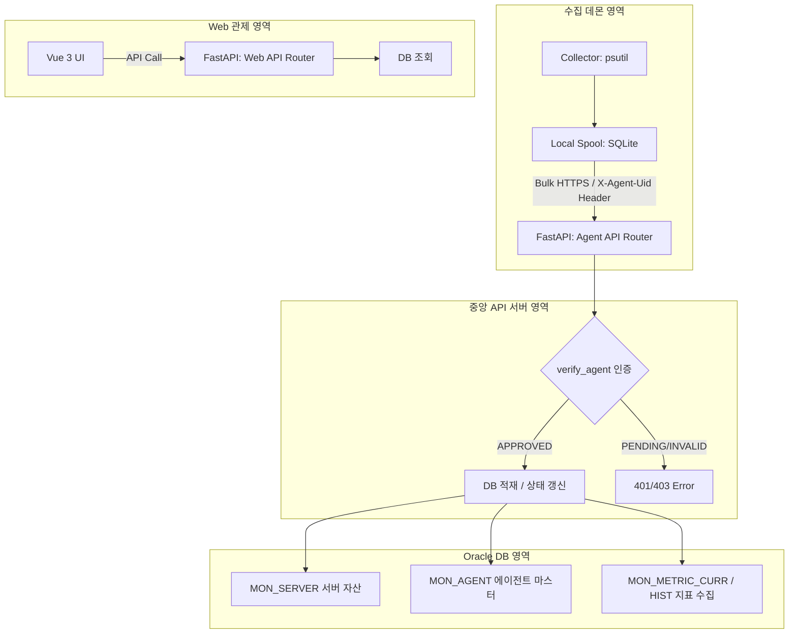

# 통합 서버 모니터링 관제 시스템 구현 현황 및 로드맵

본 문서는 **[설계서2.md](../설계서2.md)** 요구사항 정의를 기준으로 현재까지의 백엔드(FastAPI) 및 데이터베이스 연동 개발 현황을 점검하고, 향후 구현해야 할 핵심 아키텍처 및 기능별 로드맵을 정의합니다.

---

## 📊 1. 현재 아키텍처 및 데이터 흐름

현재 중앙 API 서버의 핵심 패브릭과 데이터 적재 파이프라인이 완성되어 다음과 같은 흐름으로 동작합니다.

---

## ✅ 2. 구현 완료 현황 (진행 내용)

설계서2 요구사항 중 현재 코드베이스에 구현 및 동기화가 완료된 내역입니다.

| 요구사항 ID | 기능 영역 | 구현 내용 및 연동 파일 | 완료 상태 |
|---|---|---|:---:|
| **MON-ARC-001** | 중앙 집중형 구성 | [main.py](../backend/app/main.py) 라우터 분리 (`/agent/v1`, `/api/v1`) | **완료** |
| **MON-ARC-002** | 데이터 처리 구분 | [resource.py](../backend/app/models/resource.py) 내 `MetricCurrent` 및 `MetricHistory` ORM 구성 | **완료** |
| **MON-SRV-001** | 서버 등록 | [router.py](../backend/app/api/agent/v1/router.py) 내 서버 중복 시 자동 재사용 및 갱신 로직 | **완료** |
| **MON-SRV-004** | 에이전트 등록 | [dependencies.py](../backend/app/api/dependencies.py) 내 `verify_agent` 헤더 검증 및 `mon_agent` 등록 | **완료** |
| **MON-SRV-005** | 하트비트 수집 | 에이전트 상태 이력(`mon_agent_heartbeat_hist`) 및 현재 상태 실시간 동기화 | **완료** |
| **MON-RES-001** | CPU/메모리 지표 수집 | `/agent/v1/metrics/bulk` 엔드포인트를 통한 대량 메트릭 저장 로직 구축 | **완료** |

### 🔍 상세 핵심 로직 구현 요약
1. **서버 및 에이전트 중복 제어 정책 반영**: 
   - 동일 `host_name`과 `mgmt_ip`를 가진 에이전트가 재인롤 요청을 보낼 시, 신규 서버 레코드를 추가 생성하지 않고 **기존 서버 정보를 갱신하고 에이전트 레코드(`agent_uid` 및 메타데이터)를 안전하게 업데이트**하도록 구현했습니다.
2. **에이전트 인가 제어**:
   - `verify_agent` 의존성을 모든 보호 경로에 설정하여 `APPROVED`(승인됨) 상태인 데몬만 지표 전송 및 설정 조회가 가능하도록 조치했습니다.
3. **자동화 유닛 테스트 통과**:
   - SQLite 인메모리 테스트 환경을 설계하여 4가지 주요 API 시나리오 검증을 완수했습니다.

---

## 🚀 3. 향후 구현 로드맵 (진행할 내용)

설계서2에 명시된 기준 중 앞으로 백엔드, 에이전트, 프론트엔드 영역에서 순차적으로 개발해야 하는 핵심 업무 목록입니다.

### 📅 Phase 1: 에이전트 데몬 수집기 및 로컬 큐 개발 (데몬 영역)
* **OS별 수집기(Collector) 엔진 구축**:
  * [ ] `psutil` 라이브러리를 활용한 CPU, 메모리, 디스크 가용량, 네트워크 입출력 공통 수집 로직 작성.
  * [ ] Windows 전용 수집기: `pywin32` 기반의 Windows 서비스 상태 수집 및 윈도우 이벤트 로그(System/Application) 크롤링.
  * [ ] Linux 전용 수집기: `/proc/stat`, `/proc/meminfo` 직접 파싱 및 `systemd` 서비스 관리 상태 연동.
* **로컬 장애 극복(Failover) 스풀링**:
  * [ ] 데몬에 SQLite 기반 로컬 큐 모듈을 탑재하여 통신 두절 시 지표 임시 저장 및 복구 시 일괄(Bulk) 재전송 프로세스 구현.

### 📅 Phase 2: 비동기 작업 처리기(Worker) 및 스케줄러 구축 (아키텍처 영역)
* **이벤트 판정기 (Worker)**:
  * [ ] 실시간으로 인입되는 지표값과 `MON_EVENT_RULE`의 임계값(Warning, Critical, Fatal)을 비동기로 비교하여 이벤트를 발생시키고 `MON_EVENT`에 기록하는 백그라운드 Worker 구현.
* **알림 처리기 (Worker)**:
  * [ ] 이벤트 심각도 및 알림 정책(`MON_ALERT_POLICY`)을 기준으로 메일, SMS, 메신저 등을 통해 담당자에게 알림을 발송하는 모듈 개발.
* **정기 스케줄러 (Scheduler)**:
  * [ ] **Agent 미수신 체크**: 최종 하트비트 시각이 2분을 초과한 에이전트를 감지하여 '미수신 장애' 이벤트 자동 생성.
  * [ ] **시계열 집계**: 5분/1시간/1일 단위 통계 테이블 집계 배치 구동.

### 📅 Phase 3: 관리자 포털 및 권한 시스템 구현 (Web API 및 어드민 영역)
* **인가 및 JWT 토큰 처리**:
  * [ ] 현재 Stub으로 구현되어 있는 `/auth/login` 로그인 API를 실제 `sys_user`의 비밀번호 해시 대조 및 JWT 생성 프로세스로 변환.
* **사용자 및 공통코드 관리**:
  * [ ] 관리자 전용 사용자(`SYS_USER`), 권한 매핑 CRUD 구축 및 시스템 설정 제어용 공통코드 API 설계.
* **감사 로그(Audit Log) 미들웨어**:
  * [ ] Web API를 통한 중요 CUD 작업 시 `SYS_AUDIT_LOG` 테이블에 전/후 데이터를 자동으로 아카이빙하는 감사 시스템 구현.

### 📅 Phase 4: Web 관제 프론트엔드 연동 (Web UI 영역)
* **통합 관제 대시보드**:
  * [ ] Vue 3 + TypeScript 기반으로 전반적인 인프라의 요약 상태 표시.
  * [ ] ECharts를 연동하여 특정 서버의 CPU/메모리/디스크 실시간 추세선 차트 구현.
  * [ ] 미승인 에이전트가 등록 요청을 보낼 시 관리자가 버튼 클릭 한 번으로 승인(`APPROVED`)할 수 있는 에이전트 인가 관리 화면 제공.
