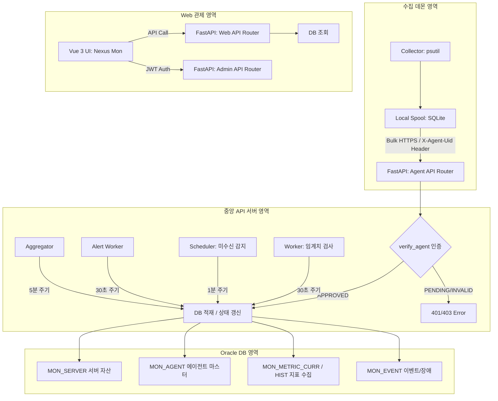

# 통합 서버 모니터링 관제 시스템 구현 현황 및 로드맵

본 문서는 **[설계서2.md](../01_requirements/설계서2.md)** 요구사항 정의를 기준으로 현재까지의 백엔드(FastAPI) 및 데이터베이스 연동 개발 현황을 점검하고, 향후 구현해야 할 핵심 아키텍처 및 기능별 로드맵을 정의합니다.

---

## 📊 1. 현재 아키텍처 및 데이터 흐름

현재 중앙 API 서버의 핵심 패브릭과 데이터 적재 파이프라인이 완성되어 다음과 같은 흐름으로 동작합니다.

---

## ✅ 2. 구현 완료 현황

| 요구사항 ID | 기능 영역 | 구현 내용 | 완료 상태 |
|---|---|---|:---:|
| **MON-ARC-001** | 중앙 집중형 구성 | main.py 라우터 분리 + CORS + lifespan 통합 | **완료** |
| **MON-ARC-002** | 데이터 처리 구분 | MetricCurrent / MetricHistory ORM | **완료** |
| **MON-SRV-001** | 서버 등록 | 서버 중복 시 자동 재사용 및 갱신 | **완료** |
| **MON-SRV-004** | 에이전트 등록 | verify_agent 헤더 검증, 에이전트 CRUD | **완료** |
| **MON-SRV-005** | 하트비트 수집 | 하트비트 이력 + 상태 실시간 동기화 | **완료** |
| **MON-RES-001** | CPU/메모리 수집 | /metrics/bulk 대량 메트릭 저장 | **완료** |
| **Phase 1** | 에이전트 데몬 | agent/ 패키지 (config, spool, collectors) | **완료** |
| **Phase 2** | Worker/Scheduler | worker.py, scheduler.py, alert_worker.py, aggregator.py | **완료** |
| **Phase 3** | 관리자 포털 | JWT 인증, 사용자 CRUD, 공통코드 API, 감사 로그 | **완료** |
| **Phase 4** | Web 프론트엔드 | Vue 3 SPA (Login, Dashboard, ServerDetail, AgentList, Events) | **완료** |
| **Phase 5** | 풀스택 통합 | CORS, Vite Proxy, 실제 API 연동, 빌드 검증 | **완료** |

---

## 🚀 3. 향후 확장 로드맵

### 📅 Phase 6: 고도화 및 운영 안정성
* [ ] 프론트엔드 다크/라이트 모드 토글 기능
* [ ] 서버 그룹핑(DC, Zone) 및 대시보드 필터
* [ ] 알림 정책 설정 UI (메일/SMS/메신저 채널 선택)
* [ ] 장애 인시던트 관리 (MON_INCIDENT 연동)
* [ ] 운영 가이드 및 배포 스크립트 작성
